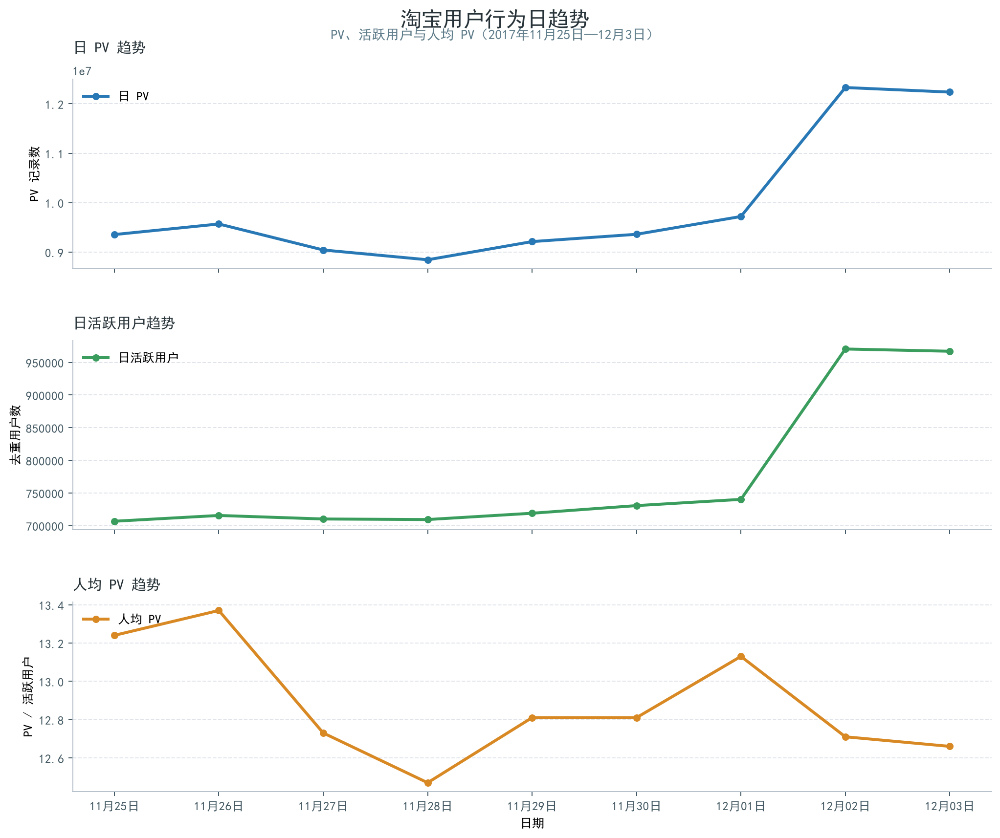
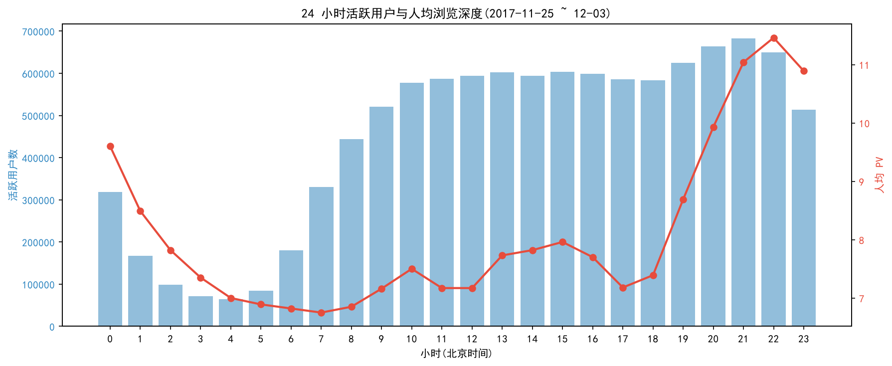
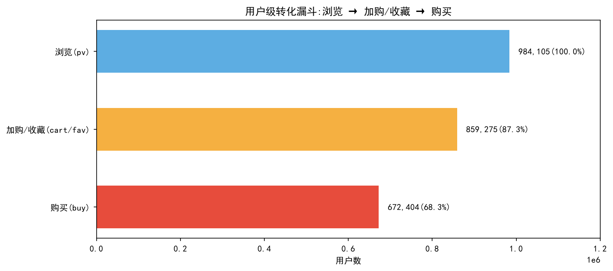
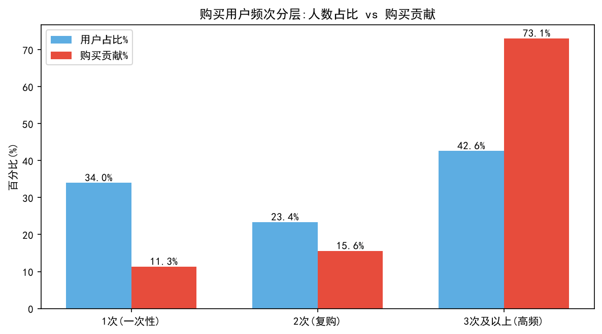

# 淘宝用户行为分析项目报告

基于约 1 亿条淘宝脱敏用户行为数据，使用 **DuckDB + Pandas + Matplotlib** 构建的完整数据分析项目。涵盖了数据清洗与建库、整体趋势概览、时间维度分析、用户转化漏斗与购买频次分层，并从数据中提炼了可落地的业务建议。

## 一、核心洞察

1. **晚间是绝对转化主力，且“逛得更深”**
   活跃用户呈“双峰”分布，晚间 21:00 达到全天最高峰。同时，晚间 20:00 - 22:00 的人均 PV 显著高于白天，说明晚间不仅人多，单人浏览深度也更深，是各大促销、Push 推送的最佳黄金时段。

2. **转化漏斗极度健康，但存在“临门一脚”流失**
   在 9 天窗口期内，浏览到最终购买的累计转化率高达 68.3%。但加购/收藏后的下单流失率为 21.7%，业务侧建议在购物车环节增加“降价提醒”或“凑单满减”进行促单。

3. **重度买家贡献超七成业绩（二八定律）**
   购买 3 次及以上的高频买家占总购买人数的 42.6%，却贡献了高达 73.1% 的购买行为。平台 GMV 极度依赖这部分核心用户，应提供专属 VIP 权益防止流失。

4. **周末/大促效应显著**
   数据期末尾的 12-02（周六）与 12-03（周日），日活跃用户从平日的约 71 万激增至近 97 万，PV 增长约 30%，呈显著的周末大促爆发特征。

---

## 二、可视化图表与深度分析

### 1. PV、活跃用户与人均 PV 日趋势

* **发现**：PV 在观察期后段明显升高，活跃用户与 PV 呈现相似变化方向，人均 PV 波动较小，未随总 PV 同步创新高，反而略有回落。
* **建议**：增量稀释掉存量，用户浏览较浅。可以针对增量用户设计浏览任务促进转化，或者发放优惠券，激发顾客下单欲望，引导下购。

### 2. 24小时活跃与浏览深度分布

* **发现**：凌晨 3-5 点处于绝对低谷（6-8 万人），从早晨 8 点开始爬升，21 点达到峰值的 68.3 万。人均 PV 在 21 点达到 11.04。
* **建议**：将核心资源位、大促开抢时间集中在 19:00 - 22:00。

### 3. 用户级转化漏斗

* **数据**：浏览用户约 98.4 万 → 加购/收藏用户约 85.9 万 → 购买用户约 67.2 万。
* **洞察**：仅 6% 的用户属于“只看不买”的流失。高达 89.3% 的购买用户走完了“浏览→加购/收藏→购买”的完整路径，说明淘宝用户的“种草-拔草”心智极强。此外，有 6.9 万（10.3%）用户属于无前置加购直接下单的“静默下单”群体。

### 4. 购买频次分层对比

* **发现**：一次性买家占了 34.0% 的人数，但仅贡献 11.3% 的购买量；高频买家占了 42.6% 的人数，却扛起了 73.1% 的购买量。
* **建议**：针对 34% 的一次性买家，需要做首单后的定向发券，促使其产生二次购买（向复购群体跃迁）。

---

## 三、技术栈

* **数据处理**：DuckDB（处理 1 亿级大表的极速引擎）
* **数据分析**：Pandas
* **可视化**：Matplotlib / Seaborn
* **环境与依赖**：Python 3.13 (Jupyter Notebook)

---

